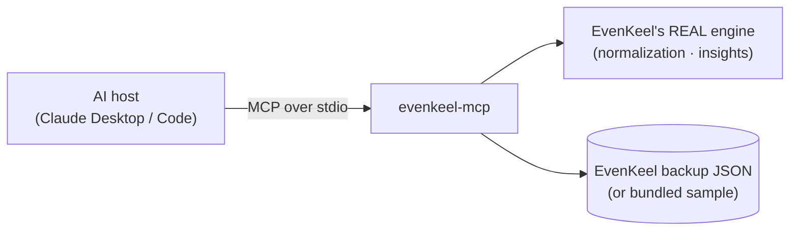

# EvenKeel MCP — your expense engine, as a standard AI capability

A working **Model Context Protocol** integration: an MCP **server** that exposes
[EvenKeel](https://github.com/boyukbas/evenkeel)'s expense data and its flagship **normalization engine**
as MCP **tools, resources, and prompts** — so any MCP-capable AI (Claude Desktop,
Claude Code, Cursor, your own agent) can reason about real finances through one
standard interface.

It's the textbook MCP use case: **take an existing app's logic and re-expose it
over a standard protocol** — built by *reusing EvenKeel's real, unit-tested
engine*, not reimplementing it. So the numbers an AI gets are byte-for-byte the
ones EvenKeel's UI shows.

> Brand-new to MCP? Read [`docs/MCP_EXPLAINED.md`](docs/MCP_EXPLAINED.md) (how it
> works + where it adds value), then [`docs/GUIDANCE.md`](docs/GUIDANCE.md) (a
> tour of this code).



## Quickstart

Requires **Node 18+** (built on Node 24). The sibling [`evenkeel`](https://github.com/boyukbas/evenkeel)
project must sit next to this one — this server imports its engine.

```bash
git clone https://github.com/boyukbas/evenkeel.git
git clone https://github.com/boyukbas/evenkeel-mcp.git
(cd evenkeel && npm install)
cd evenkeel-mcp
npm install
npm run gen:sample    # bake data/sample-backup.json from EvenKeel's real seed (once)
npm run demo          # launch the server + an MCP client; watch every primitive round-trip
```

`npm run demo` is the integration test: it spawns the server as a stdio
subprocess, does the MCP handshake, then lists and calls every tool, reads the
resources, and fetches a prompt — printing the results.

**Point it at your own money:** export a backup from EvenKeel (Settings →
*Export backup (.json)*) and set `EVENKEEL_BACKUP=path\to\backup.json`. With
nothing set, it serves a realistic bundled sample so it runs with zero setup.

## What you can ask it

Once wired into a host (see [`examples/`](examples) and
[`docs/GUIDANCE.md`](docs/GUIDANCE.md#wire-it-into-a-host)):

> *"What do I actually spend per month vs. my smoothed baseline?"* → `get_monthly_spending`
> *"Audit my subscriptions."* → `audit_subscriptions`
> *"Where can I save money?"* → `find_savings`
> *"Review my finances."* → the `review_my_finances` prompt

## Tests

```bash
npm test         # 8 behaviour tests pinning the normalization, audit, savings & insights
npm run typecheck
```

The tests run EvenKeel's **real** engine, so green is genuine evidence the
flagship math is correct end to end (e.g. a $1,320/yr premium normalizes to
exactly $110/mo; a $300 quarterly bill to $100/mo).

## Project structure

```
evenkeel-mcp/
├── src/
│   ├── server.ts       # the MCP server (tools + resources + prompts, stdio transport)
│   ├── evenkeel.ts     # domain layer: Dataset → the answers tools return (wraps EvenKeel's engine)
│   ├── dataset.ts      # load + validate an EvenKeel backup (or the bundled sample)
│   └── types.ts        # shared types (EvenKeel entities + BackupFile)
├── scripts/
│   ├── generate-sample.ts  # dev-only: EvenKeel's real seed → data/sample-backup.json
│   └── demo-client.ts      # an MCP client that drives the server (the integration test)
├── tests/evenkeel.test.ts
├── data/sample-backup.json # committed so the server runs with zero setup
├── examples/               # ready-to-paste Claude Desktop / Claude Code configs
└── docs/                   # MCP_EXPLAINED.md (concepts) · GUIDANCE.md (code tour)
```

## What this demonstrates

- **All three MCP server primitives** — *tools* (model-controlled actions),
  *resources* (app-controlled data, static **and** templated), *prompts*
  (user-controlled templates).
- **The stdio transport** and the real client↔server handshake, both ends written
  against the official `@modelcontextprotocol/sdk`.
- **Typed I/O** — Zod input schemas on every tool and a validated `outputSchema`
  with machine-readable `structuredContent`.
- **Integration over reimplementation** — the server reuses EvenKeel's pure
  engine via a path alias, with the browser-only Dexie layer isolated to a
  build-time script so the server stays headless.
- **Production-minded seams** — pluggable data source (sample ↔ real backup),
  the stdout/stderr stdio discipline, behaviour tests, and a one-command demo.

## License / status

Personal learning project. Local-first, like EvenKeel — nothing leaves your
machine; the server only reads a backup file you point it at.
