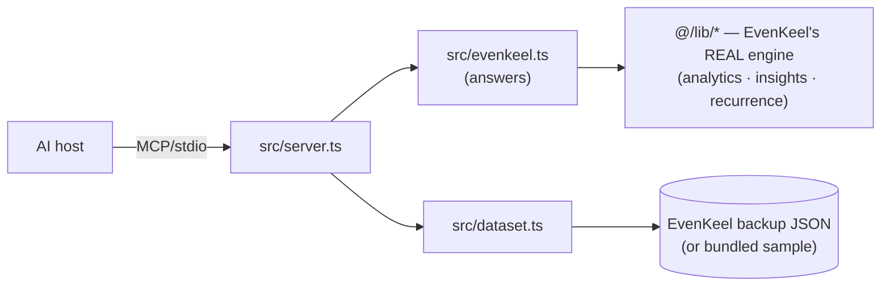

# A guided tour of the code

New to this repo? Read [`MCP_EXPLAINED.md`](MCP_EXPLAINED.md) first for the
concepts, then follow this file from the top. It walks the codebase in the order
that makes it click, and ends with how to run, wire-in, and extend it.

## The one big idea

EvenKeel already contains a **pure, unit-tested normalization engine** (in
`evenkeel/src/lib/`). We do **not** reimplement it. This server *imports it
directly* and re-exposes it over MCP. So the numbers an AI gets are byte-for-byte
the numbers EvenKeel's own UI shows — single source of truth, zero drift.



## File map

```
evenkeel-mcp/
├── src/
│   ├── server.ts       # THE MCP SERVER: registers tools/resources/prompts, stdio transport
│   ├── evenkeel.ts     # domain layer: turns a Dataset into the plain-object answers tools return
│   ├── dataset.ts      # loads + validates an EvenKeel backup (or the bundled sample)
│   └── types.ts        # re-exports EvenKeel's entity types + the BackupFile shape
├── scripts/
│   ├── generate-sample.ts  # dev-only: runs EvenKeel's REAL seed → data/sample-backup.json
│   └── demo-client.ts      # an MCP CLIENT that drives the server end-to-end (the integration test)
├── tests/
│   └── evenkeel.test.ts    # vitest: pins the normalization/audit/savings/insight answers
├── data/
│   └── sample-backup.json  # committed sample so the server runs with zero setup
├── examples/               # ready-to-paste host configs (Claude Desktop / Claude Code)
├── docs/                   # this file + MCP_EXPLAINED.md
├── tsconfig.json           # the `@/*` → ../evenkeel/src alias lives here
└── vitest.config.ts        # mirrors that alias for tests (vite doesn't read tsconfig paths)
```

## How the reuse actually works (the two tricky bits)

1. **The `@/*` alias.** EvenKeel imports its own modules as `@/lib/analytics`,
   etc. We point that same alias at EvenKeel's source in `tsconfig.json`:
   `"paths": { "@/*": ["../evenkeel/src/*"] }`. `tsx` (which runs the server)
   reads tsconfig `paths` at runtime, so `import { buildMonthlySeries } from
   "@/lib/analytics"` resolves straight into EvenKeel. Vite/vitest *don't* read
   tsconfig paths, so `vitest.config.ts` repeats the alias for tests.

2. **Keeping Dexie out of the server.** EvenKeel's data layer
   (`@/db/database.ts`) imports Dexie (browser IndexedDB). The *engine* files
   (`analytics`, `insights`, `recurrence`, `date`, `types`) don't — they're pure.
   The server imports **only** those pure modules, so no browser code runs in the
   server process. The *one* place that touches Dexie is
   `scripts/generate-sample.ts`, which runs once at build time to bake the sample
   file. The server never imports it.

## Read the files in this order

1. **`src/types.ts`** — the vocabulary. `BackupFile` is the on-disk shape
   EvenKeel exports; `Dataset` is the loaded-and-validated in-memory form.
2. **`src/dataset.ts`** — `loadDataset(source?)` resolves the data source
   (explicit path → `EVENKEEL_BACKUP` env → bundled sample), parses, and
   validates with `isEvenKeelBackup`. Swap in your real export and the server
   answers about *your* money.
3. **`src/evenkeel.ts`** — the domain layer. Four functions
   (`monthlySpending`, `subscriptionAudit`, `savingsOpportunities`,
   `financialInsights`). Each picks a month window, calls EvenKeel's engine, and
   resolves category ids → names. Pure; no MCP here. This is what the tests pin.
4. **`src/server.ts`** — the MCP wiring. `new McpServer(...)`, then
   `registerTool`/`registerResource`/`registerPrompt`, then connect a
   `StdioServerTransport`. Each tool maps 1:1 to a domain function and returns
   both human-readable `content` text *and* machine-readable `structuredContent`.
5. **`scripts/demo-client.ts`** — the other half of MCP. It launches the server
   as a subprocess and performs the real handshake/list/call flow a host does.

## Run it

```bash
npm install
npm run gen:sample     # writes data/sample-backup.json from EvenKeel's seed (once)
npm test               # 8 behaviour tests against EvenKeel's real engine
npm run demo           # launches the server + a client; prints every primitive round-tripping
npm run typecheck      # tsc, no errors
npm run dev            # run the server on stdio directly (it waits for a client)
```

### Point it at your real data
```bash
# any EvenKeel backup exported from Settings → "Export backup (.json)"
EVENKEEL_BACKUP="C:\\path\\to\\your-backup.json" npm run dev
# or:  npm run dev -- "C:\\path\\to\\your-backup.json"
```

## Wire it into a host

**Claude Code** (project-scoped): copy [`examples/mcp.json`](../examples/mcp.json)
to `.mcp.json` in a project, or:
```bash
claude mcp add evenkeel -- node "<abs>/node_modules/tsx/dist/cli.mjs" "<abs>/src/server.ts"
```
Then run `/mcp` in a session to see the tools. **Claude Desktop:** merge
[`examples/claude_desktop_config.json`](../examples/claude_desktop_config.json)
into your config and restart the app. Both use an absolute path to the `tsx` CLI
so they work regardless of the host's working directory.

Once connected, try the `review_my_finances` prompt, or just ask:
*"What do I actually spend per month, and where can I save?"*

## Extend it: add a tool in 3 steps

1. Add a pure function to `src/evenkeel.ts` (e.g. `forecast(ds, opts)`), and a
   test for it in `tests/evenkeel.test.ts` (write the test first — see the
   existing ones).
2. `server.registerTool("forecast", { title, description, inputSchema: { … Zod … } }, handler)`
   in `src/server.ts`, calling your new function.
3. `npm test && npm run demo`. The client auto-discovers the new tool — no client
   changes needed. That's the MCP payoff in miniature.

> EvenKeel already ships a `forecast` engine (`@/lib/forecast.ts`) and a
> what-if simulator — both obvious next tools if you want to keep going.
