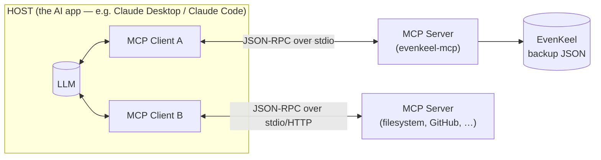

# MCP, explained — and where it adds value

A short, practical write-up of the **Model Context Protocol**, using this
server (`evenkeel-mcp`) as the running example. Read this first; then read
[`GUIDANCE.md`](GUIDANCE.md) for a tour of the code that implements it.

---

## 1. What problem does MCP solve?

An LLM on its own is a closed box: it can only reason over what's in its context
window. To be *useful* it needs to **act** (run a query, call an API, write a
file) and **read live data** (your calendar, a database, your expenses). Every
team wired this up their own way — a bespoke function-calling integration per
app, per model, per framework.

That's an **N×M problem**: *N* AI apps each need custom glue for *M* tools. Ten
apps and ten tools is a hundred one-off integrations, none reusable.

**MCP makes it N+M.** It's an open standard (introduced by Anthropic in late
2024, now broadly adopted) that defines *one* protocol between AI applications
and external capabilities. Build a tool as an MCP **server** once, and every
MCP-capable **host** can use it. Build a host once, and it can talk to every
server. The common analogy: **MCP is a USB-C port for AI** — one standard
connector instead of a drawer full of adapters.

This very repo is the proof: EvenKeel's normalization engine was trapped inside
a browser app. Wrapping it as an MCP server (≈150 lines) makes that exact logic
callable from Claude Desktop, Claude Code, Cursor, or a custom agent — **without
EvenKeel knowing anything about any particular AI**, and without re-implementing
the math.

---

## 2. The architecture: host, client, server

Three roles:

| Role | What it is | In this project |
|---|---|---|
| **Host** | The AI application the user interacts with; owns the LLM and decides what context/tools to expose. | Claude Desktop, Claude Code, the demo client |
| **Client** | A connector *inside* the host. Exactly **one client per server**, managing that single connection and the handshake. | Created by the host; `scripts/demo-client.ts` is a hand-rolled one |
| **Server** | A program that exposes capabilities (tools/resources/prompts) over MCP. Knows nothing about the LLM. | `src/server.ts` |

A host runs **many** clients, each paired 1:1 with a server. Servers stay small
and single-purpose; the host composes them.

---

## 3. The wire: JSON-RPC, a lifecycle, and two transports

- **Message format:** [JSON-RPC 2.0](https://www.jsonrpc.org/specification) —
  requests, responses, and notifications. Methods are things like
  `tools/list`, `tools/call`, `resources/read`, `prompts/get`.
- **Lifecycle:** every connection starts with an `initialize` handshake where
  the two sides **negotiate capabilities** (e.g. "I offer tools and resources";
  "I support resource subscriptions"). Then it's open for normal operation, and
  either side can send notifications (e.g. "my tool list changed").
- **Transports** — how the bytes move:
  - **stdio** *(what this server uses)* — the host launches the server as a
    **subprocess** and exchanges messages over its stdin/stdout. Perfect for
    local tools. Zero network, zero auth, dead simple.
  - **Streamable HTTP** — for remote servers, with Server-Sent Events for
    streaming. This is where OAuth, headers, and deployment concerns live.

> ⚠️ **The stdio gotcha** (and why `src/server.ts` only ever uses
> `console.error`): on stdio, **stdout *is* the protocol channel.** A stray
> `console.log` injects garbage into the JSON-RPC stream and breaks the
> connection. All human-facing logging must go to **stderr**.

---

## 4. The three server primitives — and *who controls each*

This is the conceptual heart of MCP. A server can expose three kinds of thing,
distinguished by **who decides when they're used**:

### Tools — *model-controlled* (actions)
Functions the **model** chooses to call to take an action or fetch computed
results. Analogous to `POST` endpoints. Each has a name, description, and a
typed input schema (JSON Schema, expressed here with Zod). Optionally a typed
**output** schema, so results are machine-readable, not just prose.

`evenkeel-mcp` exposes four:
`get_monthly_spending`, `audit_subscriptions`, `find_savings`, `get_insights`.
The model picks which to call based on the user's question.

### Resources — *application-controlled* (data)
Read-only data the **host** can pull into context, addressed by **URI**.
Analogous to `GET` endpoints — no side effects. The *host* (or user) decides
what to attach; the model doesn't invoke them like tools.

`evenkeel-mcp` exposes `evenkeel://dataset/summary`, `evenkeel://categories`,
and a **templated** resource `evenkeel://expenses/{month}` — one addressable
resource per month, enumerated dynamically from the data.

### Prompts — *user-controlled* (templates)
Pre-authored message templates the **user** invokes deliberately — typically
surfaced as slash commands or menu items in the host. They can take arguments
and orchestrate a multi-step task.

`evenkeel-mcp` exposes `review_my_finances` and `whats_my_true_monthly_budget`,
which tell the assistant exactly which tools to call and how to frame the answer.

> **Why the distinction matters:** it's a clean separation of control. The model
> can't silently read all your data (resources are host-gated); the user gets
> curated entry points (prompts); actions are explicit and schema-checked
> (tools). Security and UX fall out of the design.

*(Symmetrically, the **client** can expose primitives back to the server —
**sampling** lets a server ask the host's LLM to generate text, **elicitation**
lets it ask the user a question, and **roots** tell it which files it may touch.
This server doesn't need them, but they're part of the standard.)*

---

## 5. Discovery is dynamic

The host doesn't hard-code what a server offers. It **asks** at runtime:
`tools/list`, `resources/list`, `resources/templates/list`, `prompts/list`. The
server answers with names, descriptions, and schemas; the host turns those into
things the model/user can use. If the server's offerings change, it sends a
`listChanged` notification and the host re-fetches. You saw this live in the
demo: the client discovered all four tools, both prompts, and the eight
month-resources without knowing any of them in advance.

---

## 6. Where MCP adds value

- **Write once, use everywhere.** One server works across every MCP host. No
  per-app, per-model glue. (EvenKeel → Claude Desktop *and* Claude Code *and*
  your orchestrator, unchanged.)
- **Separation of concerns.** The server owns the domain logic and data access;
  the host owns the model and the conversation. Neither leaks into the other.
- **Right-sized context.** Instead of pasting a whole dataset into the prompt,
  the model pulls *exactly* what it needs through tools/resources — cheaper,
  and it scales past the context window.
- **A real security boundary.** Capabilities are explicit and negotiated; data
  (resources) is host-gated; actions (tools) are typed and auditable. The server
  is a sandbox with a declared surface.
- **Composability & ecosystem.** Hosts mix many small servers. There's a growing
  registry of off-the-shelf ones (filesystem, GitHub, Postgres, Slack, …), so
  you assemble capabilities instead of building them.
- **Dynamic, not baked-in.** Tools can appear/disappear at runtime; the model
  adapts because it discovers them live.

## 7. Honest trade-offs

- **A process and a hop.** Each server is a subprocess (or network service) with
  startup and serialization cost. For a function you only ever call in one app,
  in-process function-calling is simpler — MCP earns its keep when the capability
  is reused or the boundary matters.
- **Trust & prompt-injection.** A tool description and the data it returns enter
  the model's context. A malicious or compromised server can attempt to steer the
  model ("tool poisoning"). Hosts should require user approval for tool calls and
  treat server content as untrusted — install servers you trust.
- **Versioning.** Tool schemas are an API contract; changing them ripples to
  every host. Design them like public APIs.

---

## 8. This server, mapped to the concepts

| MCP concept | Where it lives here |
|---|---|
| Server | `src/server.ts` (`new McpServer(...)`) |
| Transport (stdio) | `StdioServerTransport` + `server.connect(...)` |
| Tools (model-controlled) | `server.registerTool(...)` ×4, Zod input schemas, one typed `outputSchema` |
| Resources (app-controlled) | `server.registerResource(...)` ×2 static |
| Resource template | `new ResourceTemplate("evenkeel://expenses/{month}", { list, complete })` |
| Prompts (user-controlled) | `server.registerPrompt(...)` ×2 |
| Capability negotiation | handled by the SDK during `initialize` |
| The host/client side | `scripts/demo-client.ts` (launch, handshake, list, call) |
| The external data source | an EvenKeel backup JSON (`src/dataset.ts`), engine reused via `@/*` |

The payoff in one sentence: **the same normalization math that powers EvenKeel's
UI is now a standard capability any AI can call — built by reusing the app's
real engine, not by reimplementing it.**
